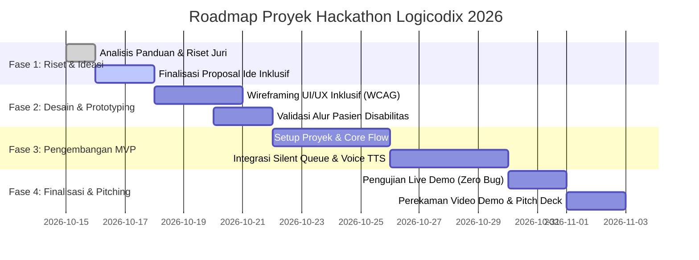

# 🚀 Roadmap & Timeline Eksekusi Tim Hackathon Logicodix 2026

Dokumen ini memuat pembagian peran, roadmap pengembangan MVP, dan target penyusunan proposal untuk tim **Logicodix 2026**.

---

## 👥 Pembagian Peran & Tanggung Jawab

| Anggota | Peran (*Role*) | Tanggung Jawab Utama |
| :--- | :--- | :--- |
| **Tama1323** | **Hustler / Project Lead (Admin)** | - Perumusan problem-solution fit & validasi data krisis kesehatan inklusif. - Penyusunan proposal, slide pitching, dan narasi presentasi lomba. - Koordinasi repo, submission, dan kepatuhan terhadap guidebook. |
| **fal / fallenheadphone** | **Hacker / Fullstack Developer** | - Arsitektur sistem & integrasi backend/API MVP. - Implementasi fitur utama (antrean ramah sensorik / silent queue, text-to-speech, peta faskes ramah difabel). - Pengujian kinerja, deployment live demo / hosting. |
| **relianxd** | **Hipster / UI/UX & Accessibility Specialist** | - Desain antarmuka inklusif berbasis WCAG 2.2 AA (kontras tinggi, font disleksia). - Prototyping interaktif (Figma) & desain aset visual. - Uji kemudahan alur pengguna (*human-centered design*) untuk penyandang disabilitas & lansia. |
| **fundamantalist** | **AI & Data Specialist / QA** | - Riset dataset kesehatan inklusif & validasi model AI. - Pengujian fungsionalitas sistem (Quality Assurance / QA). - Pengujian kesiapan live demo serta penyusunan dokumentasi teknis. |

---

## 📅 Roadmap Tahapan Lomba

---

## 🎯 4 Kunci Kemenangan Utama
1. **Dukungan Data Riil:** Memanfaatkan data resmi Kemenkes & SKI 2026 (<5% Puskesmas inklusif difabel).
2. **Aksesibilitas Nyata:** Bukan hanya tampilan menarik, tapi fungsional untuk disabilitas netra/rungu/autisme.
3. **Live Demo Siap Uji:** MVP dapat diakses langsung oleh dewan juri tanpa kendala teknis.
4. **Presentasi Terstruktur:** Memadukan storytelling masalah sosial dengan solusi teknologi digital mutakhir.
