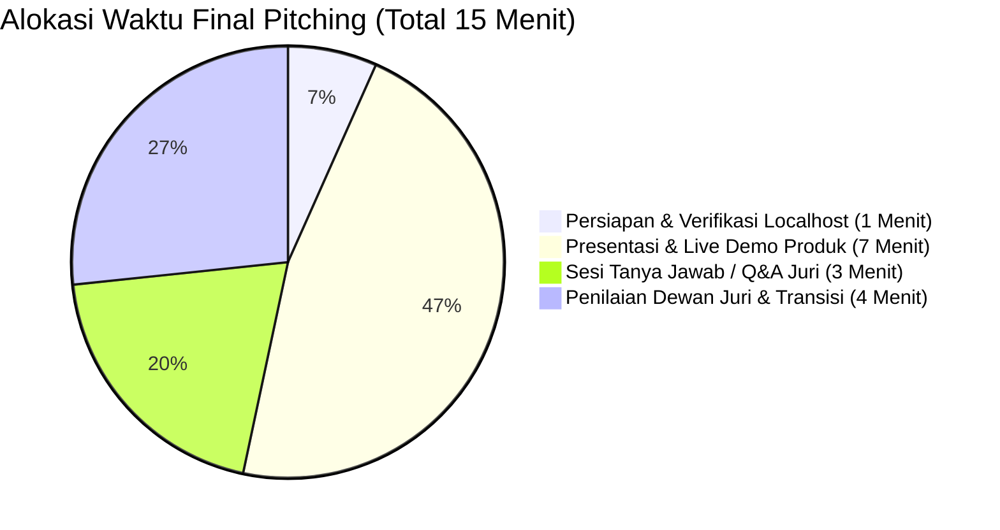

# ⏱️ Jadwal & Timeline Resmi LOGICODIX 2026

Dokumen ini merangkum seluruh timeline, jadwal penting, durasi pengerjaan, dan alokasi waktu babak kompetisi berdasarkan **Guidebook Resmi LOGICODIX 2026**.

---

## 📅 Timeline Utama Kompetisi

| Tahap | Hari & Tanggal | Agenda & Kegiatan | Keterangan & Ketentuan |
| :---: | :--- | :--- | :--- |
| **01** | **Senin, 7 September 2026 – Selasa, 6 Oktober 2026** | **Open Registrasi Hackathon Batch 1** | Pendaftaran tim melalui portal resmi LOGICODIX. |
| **02** | **Rabu, 7 Oktober 2026 – Jumat, 6 November 2026** | **Open Registrasi Hackathon Batch 2** | Gelombang pendaftaran reguler/akhir. |
| **03** | **Sabtu, 7 November 2026** | **Mentoring & Technical Meeting Penyisihan** | - Pelaksanaan daring (Zoom / Google Meet). - Sesi 1: *Ideation & Problem Mapping* - Sesi 2: *Technical & AI Integration* |
| **04** | **Sabtu, 7 November 2026 – Sabtu, 14 November 2026** | **Hacking Week (Masa Pengerjaan Hackathon)** | - Durasi pengerjaan: **1 Minggu (7 Hari)**. - Pengembangan MVP berbasis Web/Mobile. - Dikerjakan daring (rumah/kampus masing-masing). |
| **05** | **Sabtu, 14 November 2026** | **Last Submission (Batas Akhir Pengumpulan)** | Pengumpulan akhir via GitHub repo & Video Demo. Setelah batas waktu, kode dilarang diubah. |
| **06** | **Sabtu, 21 November 2026** | **Pengumuman Finalis (Top 8 Finalis)** | Kurasi dewan juri memilih 8 tim terbaik menuju Grand Final. |
| **07** | **Minggu, 22 November 2026** | **Technical Meeting Peserta Babak Final** | Pembahasan tata tertib presentasi luring, live demo, & nomor urut tampil. |
| **08** | **Minggu, 29 November 2026** | **Puncak Acara LOGICODIX 2026 (Grand Final & Seminar)** | - Babak Final Luring (Offline Pitching & Live Demo). - *National Tech Seminar* ("Unlocking the Future"). - Pengumuman Juara (Juara 1, 2, 3). |

---

## ⏱️ Rincian Alokasi Waktu Teknis

### 1. Masa Pengerjaan (*Hacking Week*)
* **Durasi Total:** 7 Hari (1 Minggu)
* **Target Output:** Minimum Viable Product (MVP) fungsional berbasis Web atau Mobile.

### 2. Video Demonstrasi (*Submission Requirement*)
* **Durasi Video:** **3 – 5 Menit**
* **Ketentuan Video:**
  * Menampilkan fitur aplikasi secara langsung (*screen recording live application*).
  * Menunjukkan integrasi fitur Artificial Intelligence (AI).
  * Video berupa demonstrasi alur produk murni **tanpa suara presentasi** atau penjelasan lisan dari peserta.

### 3. Sesi Pitching Babak Final Offline (15 Menit per Tim)
Pada babak Grand Final luring (Top 8 Tim), setiap tim dialokasikan total **15 menit** dengan pembagian waktu ketat:

| Segmen Waktu | Durasi | Deskripsi Aktivitas |
| :--- | :---: | :--- |
| **Persiapan & Setup** | **1 Menit** | Pemasangan laptop di hadapan juri dan verifikasi aplikasi berjalan di *localhost*. |
| **Pitching & Live Demo** | **7 Menit** | Presentasi *slide deck* narasi masalah & live demo fungsionalitas aplikasi di hadapan juri industri. |
| **Tanya Jawab (Q&A)** | **3 Menit** | Menjawab pertanyaan kritis dari dewan juri terkait solusi, teknologi, dan implementasi. |
| **Penilaian & Transisi** | **4 Menit** | Juri memasukkan skor penilaian dan transisi ke tim finalis berikutnya. |

---

## 📊 Kriteria & Bobot Penilaian (Untuk Manajemen Waktu Pengembangan)

| Kriteria Utama | Bobot | Aspek Penilaian Utama |
| :--- | :---: | :--- |
| **Problem-Solution Fit** | **25%** | Ketajaman identifikasi masalah & kesesuaian solusi dengan kebutuhan riil masyarakat. |
| **Technology Innovation** | **25%** | Kreativitas pemanfaatan teknologi digital & nilai tambah integrasi AI. |
| **Software Engineering** | **25%** | Fungsionalitas MVP, kualitas source code, arsitektur sistem, dan dokumentasi GitHub. |
| **UI/UX Design** | **15%** | Kemudahan penggunaan (*ease of use*), alur intuitif, dan estetika antarmuka inklusif. |
| **Green IT & Ethics** | **10%** | Efisiensi komputasi, perlindungan privasi data, dan transparansi AI. |
| **Total** | **100%** | |

---

## 📞 Kontak Panitia Resmi
* **Rohman:** `+62 899-8713-858`
* **Rivana:** `+62 831-4214-2252`
* **Instagram Resmi:** `@logicodix`
