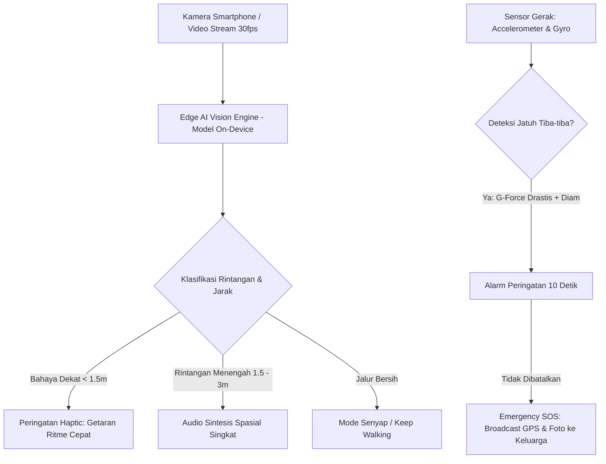

# 🛠️ Fitur Minimum Viable Product (MVP) & Spesifikasi Teknis

Dokumen ini memuat spesifikasi arsitektur teknis dan detail fungsional untuk membangun prototipe **NetraNav AI** selama tahapan hackathon dan pengembangan jangka panjang.

---

## 🏗️ 1. Diagram Alur Sistem (System Flowchart)

---

## 🎯 2. Spesifikasi 4 Fitur Kunci MVP

### Fitur 1: Real-Time Hazard & Obstacle Detection (Edge AI Vision)
* **Deskripsi:** Kamera belakang ponsel membaca area jalan di depan secara kontinyu dengan frame rate optimal (15–30 fps).
* **Kategori Objek yang Dikenali:**
  1. **Ground Drop & Hazards:** Lubang selokan terbuka (*potholes/manholes*), tangga turun curam, selokan tanpa pembatas.
  2. **Middle Obstacles:** Tiang listrik, pohon, pembatas jalan (*bollards*), motor parkir liar, tong sampah, pejalan kaki lain.
  3. **Head-Level Obstacles:** Dahan pohon rendah, spanduk melintang, terpal tenda PKL rendah.
* **Perkiraan Jarak (*Depth Estimation*):** Membagi bidang tangkapan menjadi 3 zona:
  * **Zona Bahaya Merah (< 1.2 meter):** Harus berhenti melangkah.
  * **Zona Waspada Kuning (1.2 – 3 meter):** Pengguna bersiap membelokkan arah langkah.
  * **Zona Aman Hijau (> 3 meter):** Jalur bebas hambatan.

---

### Fitur 2: Dual Sensory Feedback (Haptic + Spatial Audio)
* **Filosofi Desain:** Menghindari *Cognitive & Audio Overload*. Telinga pengguna adalah instrumen keselamatan utama untuk mendengar deru kendaraan. Karena itu, audio hanya berbunyi jika esensial; sisanya dikomunikasikan via getaran.
* **Pola Getaran Smartphone (`navigator.vibrate`):**
  * `[50ms]`: Ketukan halus = Konfirmasi sistem aktif dan jalur bersih.
  * `[100ms, 100ms, 100ms]`: Tiga getaran sedang = Rintangan mendekat di jarak 2 meter.
  * `[300ms, 100ms, 500ms]`: **Getaran panjang kuat & berulang = BAHAYA! STOP SEGERA!**
* **Audio Spasial (Web Speech API):**
  * Kalimat padat, ringkas, tanpa basa-basi: *"Tiang di depan, satu meter"*, *"Tangga turun di kanan"*, *"Awas kepala, ada spanduk"*.

---

### Fitur 3: Turn-by-Turn Pedestrian Voice Navigation
* **Deskripsi:** Navigasi berbasis suara yang diprioritaskan untuk rute pedestrian dan trotoar ber-guiding block, bukan rute aspal kendaraan.
* **Fitur Utama:**
  * Penanda langkah: *"Maju 25 langkah mengikuti jalur ubin, lalu putar arah 90 derajat ke kiri."*
  * Integrasi kompas digital smartphone untuk akurasi arah hadap badan pengguna.

---

### Fitur 4: Smart Fall Detection & Emergency SOS Guardian
* **Deskripsi:** Perlindungan darurat otomatis saat pengguna tersandung atau terperosok ke dalam lubang.
* **Mekanisme Sensor:**
  * Membaca akselerasi mendadak (*free-fall spike*) diikuti kondisi statis tanpa gerakan selama 3 detik.
  * Mengaktifkan suara hitung mundur keras 10 detik: *"Deteksi jatuh aktif, tekan layar 2x untuk membatalkan."*
  * Jika tidak dibatalkan: Otomatis mengirimkan link Google Maps lokasi GPS presisi dan foto kamera ke WhatsApp keluarga/wali terdaftar.

---

## 💻 3. Rekomendasi Tech Stack untuk Hackathon

| Lapisan Teknologi | Pilihan Teknologi | Alasan Pemilihan |
| :--- | :--- | :--- |
| **Frontend UI/UX** | **Progressive Web App (PWA) / HTML5 + JS ESNext** | Dapat diakses langsung via browser smartphone tanpa instalasi rumit, ringan, dan mendukung sensor perangkat. |
| **Computer Vision Engine** | **TensorFlow.js / ONNX Runtime Web / MediaPipe** | Model terkompresi (MobileNet / YOLOv8-nano) yang dieksekusi via WebAssembly/WebGL langsung di GPU HP secara offline. |
| **Speech Engine** | **Web Speech API (`SpeechSynthesis`)** | Native bawaan browser Android & iOS, respons instan nol latensi, tanpa konsumsi kuota data. |
| **Sensor Hardware** | **DeviceMotion API & Vibration API** | Membaca akselerometer, giroskop, kompas arah, dan modul getar HP. |
| **Offline Reliability** | **100% Standalone `localhost` Ready** | Sangat krusial saat demo di hadapan juri di Auditorium UNESA agar tidak gagal akibat sinyal lemah. |
