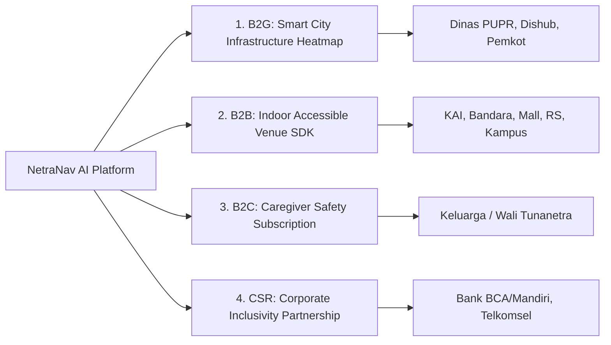

# 💼 Model Bisnis, Monetisasi, & Analisis Pasar (B2G, B2B, B2C)

Dokumen ini membedah strategi kelayakan bisnis (*business viability*), aliran pendapatan (*revenue streams*), dan target pasar untuk membuktikan kepada juri hackathon dan investor bahwa **NetraNav AI** adalah produk yang berkelanjutan secara finansial.

---

## 🎯 Paradigma Inti: "Who Pays?" (Siapa yang Membayar?)

> **Prinsip Utama:** Aplikasi ini **100% GRATIS** bagi pengguna tunanetra untuk memastikan adopsi massal dan dampak sosial inklusif.  
> Pihak yang membayar adalah **Pemerintah Kota (B2G)**, **Pengelola Fasilitas Publik & Transportasi (B2B)**, dan **Keluarga/Caregiver (B2C)**.

---

## 💰 4 Aliran Pendapatan Utama (Revenue Streams)

### 1. Model B2G (Business-to-Government): Smart City Infrastructure Audit
* **Target Klien:** Dinas Pekerjaan Umum & Penataan Ruang (PUPR), Dinas Perhubungan (Dishub), Badan Perencanaan Pembangunan Daerah (Bappeda).
* **Nilai yang Ditawarkan:**
  * Pemerintah memiliki kewajiban undang-undang dan anggaran miliaran rupiah per tahun untuk perbaikan trotoar ramah difabel, tetapi **butuh data pemetaan titik riil**.
  * Saat ribuan tunanetra berjalan menggunakan NetraNav AI, sistem merekam data anonim titik GPS trotoar rusak, got terbuka, atau ubin pemandu yang hilang.
  * **Produk:** *City Inclusivity & Infrastructure Audit Dashboard*.
  * **Skema Monetisasi:** Kontrak lisensi software data tahunan (*Government SaaS*) bernilai **Rp 150 Juta – Rp 500 Juta per Kota/Kabupaten**.

---

### 2. Model B2B (Business-to-Business): Indoor Accessible Navigation SDK
* **Target Klien:** PT Kereta Api Indonesia (KAI), MRT/LRT Jakarta, Pengelola Bandara (InJourney/Angkasa Pura), Mall Perbelanjaan, Rumah Sakit Vertikal, dan Universitas.
* **Dasar Hukum & Kebutuhan:**
  * **UU No. 8 Tahun 2016 tentang Penyandang Disabilitas:** Fasilitas publik wajib menyediakan sarana mandiri bagi penyandang disabilitas.
  * **Skor ESG (Environmental, Social, Governance):** Perusahaan terbuka dan BUMN wajib melaporkan inisiatif inklusivitas sosial kepada regulator dan investor global.
* **Produk:** Pemetaan digital presisi dalam ruangan (*Indoor Accessible Mesh*) untuk membantu tunanetra menuju loket, gerbang stasiun, toilet difabel, atau poli dokter.
* **Skema Monetisasi:** Biaya setup pemetaan awal (Rp 15–30 Juta/gedung) + Biaya pemeliharaan software tahunan (**Rp 25 Juta/tahun per lokasi**).

---

### 3. Model B2C Freemium: Paket Keamanan Keluarga (*Caregiver Guardian*)
* **Untuk Pengguna Tunanetra:** Seluruh fitur keselamatan esensial (deteksi rintangan jalan, pemindai lubang, suara pemandu) **selamanya gratis**.
* **Untuk Keluarga / Wali (Fitur Premium):**
  * *Live Telemetry & GPS Tracking:* Keluarga dapat melihat peta posisi berjalan secara langsung di HP mereka.
  * *Smart Geo-Fencing:* Notifikasi instan ke WhatsApp keluarga jika pengguna keluar dari rute atau radius aman yang ditentukan.
  * *Video Emergency Streaming:* Saat terdeteksi jatuh, HP otomatis menyiarkan video langsung ke HP keluarga.
* **Harga Langganan:** Sangat terjangkau, **Rp 29.000 – Rp 49.000 / bulan**.

---

### 4. Kemitraan CSR BUMN & Perbankan (Corporate Sponsorship)
* **Target Mitra:** Bank Nasional (BCA, Mandiri, BRI) & Provider Telekomunikasi (Telkomsel, Indosat).
* **Nilai Kolaborasi:**
  * Bank ingin nasabah tunanetra dapat berjalan dengan aman menuju mesin ATM atau kantor cabang terdekat (*Financial Inclusion Campaign*).
  * Telco menyediakan *zero-rating* kuota gratis serta pendanaan CSR untuk program pengadaan aksesoris tali gantung dada (*chest lanyard*) bagi ribuan tunanetra.

---

## 📈 3. Estimasi Ukuran Pasar (Market Sizing Indonesia)

* **TAM (Total Addressable Market):**  
  3,75 Juta penyandang disabilitas penglihatan di Indonesia x Kebutuhan mobilitas harian = **Potensi dampak sosial skala nasional**.
* **SAM (Serviceable Addressable Market):**  
  ~1,2 Juta tunanetra di wilayah perkotaan (Jabodetabek, Surabaya, Bandung, Medan, Semarang) yang aktif memiliki dan mengoperasikan smartphone Android.
* **SOM (Serviceable Obtainable Market - Tahun Pertama):**  
  * 10.000 Pengguna aktif komunitas Pertuni di Jawa Timur & Jakarta.
  * 3 Pilot Project B2G Pemerintah Kota (Surabaya, Solo, DKI Jakarta).
  * 15 Titik Stasiun & Fasilitas Publik B2B.
