# 🗣️ User Journey & Alur Interaksi Suara (Voice-First Autonomous Guardian)

Dokumen ini membedah alur interaksi pengguna (*User Flow*) lengkap dari awal membuka aplikasi hingga tiba di lokasi tujuan, didesain khusus agar ramah tunanetra secara **100% tanpa sentuhan layar (*Zero-Touch & Voice-First UX*)**.

---

## 💎 Nilai Jual Utama: "Jauh Lebih Murah & Tanpa Hardware Tambahan"

* **Solusi Pasar Saat Ini:** Mengharuskan pengguna membeli tongkat sensor pintar impor (*Smart Cane*) seharga **Rp 8.000.000 – Rp 10.000.000** atau kacamata pintar (*smart glasses*) seharga belasan juta rupiah.
* **Keunggulan NetraNav AI:** **GRATIS / Jauh Lebih Murah**, karena berjalan 100% di atas smartphone Android / iOS yang sudah dimiliki teman-teman tunanetra setiap hari. Tidak ada biaya pembelian alat tambahan!

---

## 🚶‍♂️ Diagram Alur Pengalaman Pengguna (End-to-End User Flow)

```mermaid
sequenceDiagram
    autonumber
    actor User as Pengguna Tunanetra
    participant Assistant as Siri / Google Assistant
    participant App as NetraNav AI Engine
    participant Camera as Kamera & Edge AI Vision
    participant Sensor as Haptic & GPS Navigation

    User->>Assistant: "Hai Google / Hey Siri, buka NetraNav"
    Assistant->>App: Meluncurkan aplikasi di background
    App->>User: Audio: "Halo! NetraNav siap mendampingi Anda. Ada yang bisa saya bantu?"
    
    alt Opsi A: Menanyakan Lokasi Saat Ini
        User->>App: "Saya sekarang ada di mana?"
        App->>User: Audio: "Anda berada di trotoar Jalan Ketintang, dekat UNESA, menghadap ke arah Utara."
    else Opsi B: Meminta Navigasi ke Tempat Tujuan
        User->>App: "Antarkan saya ke Stasiun Wonokromo"
        App->>User: Audio: "Rute pejalan kaki ke Stasiun Wonokromo siap (jarak 400 meter). Apakah siap melangkah?"
        User->>App: "Siap / Ya"
        
        rect rgb(20, 30, 50)
            Note over App,Camera: MODE PEMANDU AKTIF (REAL-TIME GUARDIAN)
            App->>Camera: Aktifkan video stream on-device
            App->>Sensor: Aktifkan GPS & Haptic vibrator
            loop Selama Perjalanan Menuju Lokasi
                Camera-->>App: Deteksi: "Tiang di depan jarak 1.5 meter"
                App->>Sensor: Getaran haptic panjang di HP
                App->>User: Suara singkat: "Awas ada tiang, geser sedikit ke kiri."
                Sensor-->>App: Turn-by-Turn: "Lurus 20 langkah di jalur kuning."
            end
        end
        
        Note over App,User: TIBA DI LOKASI TUJUAN
        Sensor-->>App: Radius tujuan tercapai (GPS + Vision Check)
        App->>User: Audio: "Alhamdulillah, Anda telah tiba di Stasiun Wonokromo. Pemandu dinonaktifkan."
        App->>Camera: Stop streaming (Hemat baterai Green IT)
    end
```

---

## 📋 Rincian Tahapan Alur Kerja Sistem (Step-by-Step)

### 1. Hands-Free App Activation (Aktivasi Tanpa Sentuhan)
* **Tantangan:** Tunanetra kesulitan mencari icon aplikasi kecil di layar ponsel.
* **Solusi NetraNav:** Cukup gunakan asisten suara bawaan smartphone:
  * Android: *"Hai Google, buka NetraNav"* (Google Assistant / App Action Shortcut).
  * iOS: *"Hey Siri, buka NetraNav"* (Siri Shortcuts integration).

---

### 2. Proactive Voice Greeting & Listening
* Begitu aplikasi terbuka, NetraNav tidak menunggu pengguna menekan tombol.
* Aplikasi langsung menyapa via suara ramah (*Text-to-Speech*):  
  🗣️ *"Halo, NetraNav siap membantu Anda. Ada yang bisa saya bantu?"*
* Mikrofon langsung aktif otomatis (*Speech Recognition*) dengan nada beep lembut penanda siap mendengarkan.

---

### 3. Ragam Perintah Suara (*Variative Voice Intent*)

#### Kasus A: Informasi Keberadaan Diri ("Where Am I?")
* **Pengguna bertanya:** *"Saya di mana?"* atau *"Ini jalan apa?"*
* **Sistem memproses:** Mengambil koordinat GPS presisi + *Reverse Geocoding* + Kompas magnetik.
* **Jawaban AI:**  
  🗣️ *"Anda saat ini berada di trotoar Jalan Ketintang No. 12, sekitar 50 meter sebelum halte bus, menghadap ke arah timur."*

#### Kasus B: Navigasi Menuju Suatu Tempat ("Take Me To...")
* **Pengguna meminta:** *"Tolong antarkan saya ke minimarket terdekat"* atau *"Bantu saya jalan ke Stasiun Wonokromo"*.
* **Sistem memproses:**
  * Mencari lokasi target via API rute pejalan kaki.
  * Memprioritaskan jalur yang memiliki trotoar dan menghindari jalan raya berbahaya.
  * Mengonfirmasi rute:  
    🗣️ *"Rute ke Indomaret terdekat ditemukan. Jarak 250 meter dengan jalur pemandu. Apakah Anda siap jalan sekarang?"*
  * Pengguna menjawab: *"Siap"* atau *"Ya"*.

---

### 4. Real-Time Multimodal Active Guardian (Mata & Pemandu Digital)
Setelah tujuan dikonfirmasi, sistem otomatis menyalakan **Trio Sensor Keselamatan**:

1. **Live Camera (Edge AI Vision):**
   * Kamera terus memindai objek di depan pengguna (30 fps).
   * Selalu memberi tahu apa yang ada di depan: *"Awas lubang got di kanan"*, *"Ada undakan tangga turun 3 langkah lagi"*, *"Dahan pohon rendah setinggi dahi di depan"*.
2. **Pola Getaran HP (Haptic Feedback):**
   * Pengguna merasakan bahaya langsung di telapak tangan tanpa perlu menunggu suara selesai bicara:
     * Getaran ritmis cepat = **STOP SEGERA (Bahaya Kritis)**.
     * Getaran halus dua ketukan = Jalur aman, teruskan melangkah.
3. **Panduan Navigasi Belokan:**
   * Memberikan estimasi berbasis langkah: *"Jalan lurus 15 langkah, lalu bersiap belok kiri di persimpangan zebra cross."*

---

### 5. Auto-Stop Saat Tiba di Lokasi (Graceful Standdown)
* **Kondisi Berhenti:**
  * Saat koordinat pengguna telah mencapai target tujuan:
  * Suara AI mengumumkan secara ramah:  
    🗣️ *"Anda telah tiba dengan selamat di tujuan: Stasiun Wonokromo. Sistem pemandu dan kamera otomatis dinonaktifkan. Semoga perjalanan Anda menyenangkan!"*
* **Efisiensi Baterai (*Green IT*):**
  * Kamera, pemrosesan vision, dan sensor GPS langsung berhenti seketika, mencegah panas berlebih dan menghemat daya baterai ponsel.
